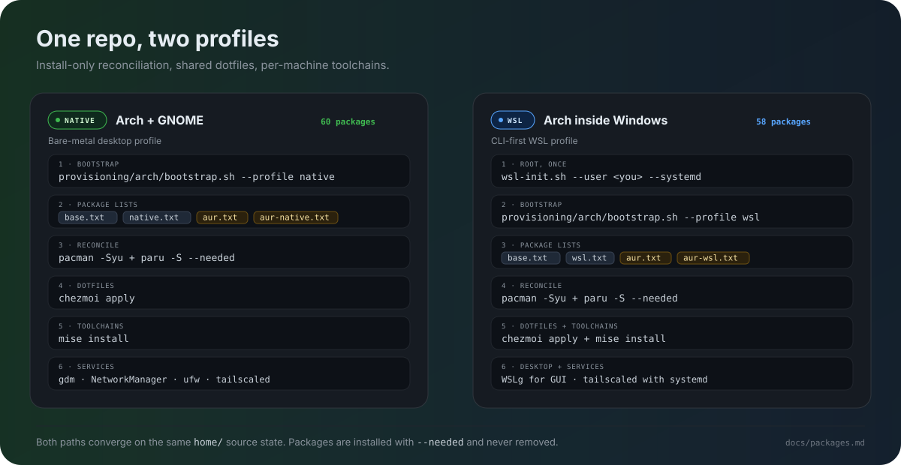

# Documentation

Start with the task you need instead of reading everything:

| I need to... | Read |
| --- | --- |
| Set up a native Arch + GNOME machine | [Bootstrapping a machine — native](bootstrap.md#native-arch--gnome) |
| Set up Arch inside WSL | [Bootstrapping a machine — WSL](bootstrap.md#arch-linux-in-wsl) |
| Add, remove, or audit a package | [Package catalog](packages.md) |
| Fix SSH, GitHub, gcloud, Tailscale, BWS, or MCP auth | [Authentication and SSH](auth.md) |
| Look up a shell, Git, chezmoi, mise, WSL, or secrets workflow | [Tips and tricks](tips-and-tricks.md) |
| Recover a broken shell or dotfiles | [Tips — recovery moves](tips-and-tricks.md#recovery-moves) |
| Check shell, editor, OpenCode, and Git defaults | [Tooling and defaults](tooling.md) |
| Understand a design choice | [Decisions and rationale](decisions.md) |
| See the Windows-side status | [Windows notes](windows.md) |

## Reference documents

| Document | What it covers |
| --- | --- |
| [Bootstrapping](bootstrap.md) | Native and WSL install order, system maintenance, backups, Git hooks, and day-2 commands. |
| [Package catalog](packages.md) | All 67 tracked packages (61 native, 58 WSL) plus the bootstrap-managed OpenCode CLI and 18 optional Nerd Fonts, with Native/WSL badges, per-file counts, the mise toolchains, and the install → record → audit loop. |
| [Tooling and defaults](tooling.md) | Fish, mise, Go, completions, OpenCode, Git defaults, and editor/app defaults. |
| [Tips and tricks](tips-and-tricks.md) | Fish, Git, chezmoi, mise, WSL, secrets, OpenCode, recovery, and a small maintenance rhythm. |
| [Authentication and SSH](auth.md) | Key, GitHub, gcloud, Tailscale, BWS, and MCP setup and troubleshooting. |
| [Decisions](decisions.md) | Tooling-language rationale, optional Git defaults, the shared keyring decision, and the BWS private-key decision. |

## Source of truth

`provisioning/arch/packages/*.txt` and the scripts are the source of truth.
`just test` runs `tests/check-docs.sh`, which verifies the 67 total / 61 native /
58 WSL counts here, in the README, package catalog, and provisioning SVG, and
checks every relative Markdown link and local asset. Update the docs and the
checker together when a package list changes. The package lists are install-only:
bootstrap adds missing packages and never removes anything, and the audit makes
drift visible.

## Environment badges

| Badge | Meaning |
| --- | --- |
|  | Native Arch and WSL |
|  | Native Arch + GNOME only |
|  | Arch inside WSL only |
|  | Arch User Repository |

## Back to

- [Project README](../README.md)
- [Validation commands](../README.md#validation)
