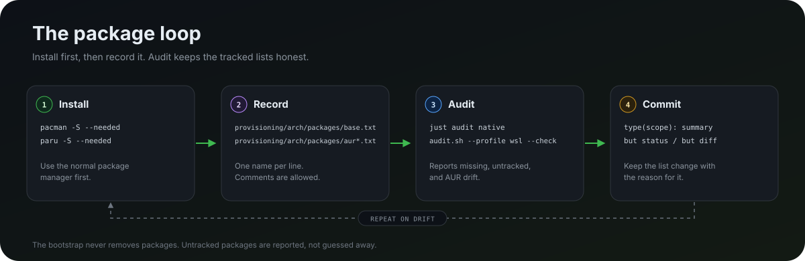

# Package catalog

This is the complete inventory of `provisioning/arch/packages/`: every required
package the bootstrap tracks, the profile it lands on, and the reason it is
there. The
catalog also covers the OpenCode CLI installed by the bootstrap outside pacman
and the optional Nerd Fonts offered by the interactive font step.

The required lists are **install-only**. Bootstrap adds missing packages with
`--needed` and never removes anything. Removing a package is a deliberate manual
step. Optional fonts are selected at install time and are likewise never removed
automatically.


## At a glance

There are **67 tracked required package names**:

- **52** are installed on both profiles: 47 official packages plus 5 AUR packages
- **9** are native-only: 5 official packages plus 4 AUR packages
- **6** are WSL-only: 5 official packages plus 1 AUR package

There are also **18 optional Nerd Fonts** in
`provisioning/arch/packages/fonts.txt`. They are not installed by default and
are never required by the audit. The OpenCode CLI is bootstrap-managed from the
verified npm release, is not counted here, and is not audited as a package.

| Profile | Package lists | Packages | Entry point |
| --- | --- | ---: | --- |
|  Native Arch + GNOME | `base.txt` + `native.txt` + `aur.txt` + `aur-native.txt` | 61 | `./provisioning/arch/bootstrap.sh --profile native` |
|  Arch inside WSL | `base.txt` + `wsl.txt` + `aur.txt` + `aur-wsl.txt` | 58 | `./provisioning/arch/bootstrap.sh --profile wsl` |

Counts are required package names only; the optional fonts are additional.
`paru` is bootstrapped automatically when an AUR list is non-empty, so it is not
tracked as a package. `base-devel` is a meta
package in current Arch, not a group. Counts are current for this revision; the
files in `provisioning/arch/packages/` remain the source of truth.

## Badge legend

| Badge | Meaning |
| --- | --- |
|  | Installed on native Arch and on WSL |
|  | Native Arch + GNOME only |
|  | Arch inside WSL only |
|  | Built from the Arch User Repository |

Everything in an `aur*.txt` list is built from the Arch User Repository; the
other package lists come from the official Arch repositories. The OpenCode CLI
and mise toolchains are managed outside these lists.

## Both profiles — official repositories

Source: `provisioning/arch/packages/base.txt` — 47 packages.

| Package | Env | What it gives you | Notes |
| --- | :---: | --- | --- |
| `actionlint` |  | Lints GitHub Actions workflow files. | Runs in `just lint`. |
| `arch-audit` |  | Checks installed packages against Arch Security Team advisories. | Run after system upgrades. |
| `atuin` |  | Searchable shell history backed by a local database. | Local-only; no sync account is configured. |
| `base-devel` |  | Build toolchain required by `makepkg` and AUR builds. | Meta package; the audit compares it directly. |
| `bat` |  | `cat` with syntax highlighting and Git markers. | Not the default `PAGER`; `less` is. |
| `bats` |  | Bash Automated Testing System. | Runs the repository's shell tests. |
| `chezmoi` |  | Applies the `home/` source state to the machine. | Bootstrap points `sourceDir` at this repo. |
| `curl` |  | HTTP/HTTPS client for downloads and APIs. | — |
| `difftastic` |  | Syntax-aware structural diff. | Wired as `git dt` when available. |
| `dust` |  | Visual disk-usage tree. | — |
| `duf` |  | Disk space and mount overview. | — |
| `eza` |  | Modern `ls` with icons, Git status, and tree view. | — |
| `fd` |  | Fast `find` with sensible ignore rules. | — |
| `fish` |  | Interactive shell. | Bootstrap sets it as the login shell. |
| `fzf` |  | Fuzzy finder for files, history, and completion. | Fish bindings load in interactive shells. |
| `git` |  | Distributed version control. | Commits and tags are SSH-signed by default. |
| `git-absorb` |  | Turns staged changes into `fixup!` commits automatically. | Useful before an autosquash rebase. |
| `git-delta` |  | Syntax-highlighting pager for Git diffs. | Wired as `core.pager` when available. |
| `github-cli` |  | `gh` for GitHub auth, pull requests, issues, and SSH keys. | Authenticated by `provisioning/arch/auth.sh`. |
| `gitleaks` |  | Scans staged changes and Git history for secrets. | Runs in the pre-commit hook and CI. |
| `gitui` |  | Terminal UI for Git. | — |
| `gnome-keyring` |  | Secret Service implementation and keyring daemon. | Native GNOME ships it; WSL needs it for GitButler and the `bws` wrapper. |
| `gnupg` |  | OpenPGP implementation for GPG workflows and package signing. | — |
| `jq` |  | Command-line JSON processor. | — |
| `just` |  | Task runner for the repository recipes. | Start with `just --list`. |
| `kubectl` |  | Kubernetes command-line client. | — |
| `less` |  | Terminal pager. | Used for `PAGER` and `MANPAGER`. |
| `libsecret` |  | Secret Service client library and `secret-tool`. | The `bws` wrapper reads the token through `secret-tool` on both profiles. |
| `man-db` |  | Manual pages and the `man` command. | — |
| `mise` |  | Toolchain manager for Node, Bun, pnpm, and friends. | Global config: `~/.config/mise/config.toml`. |
| `nano` |  | Small terminal editor. | Fallback `EDITOR` when Neovim/Vim are absent. |
| `openssh` |  | `ssh`, `ssh-keygen`, and `ssh-agent`. | Enables `sshd.service`; key-only auth once `authorized_keys` exists; also powers Git commit signing. |
| `pacman-contrib` |  | `paccache` and other pacman helpers. | `paccache.timer` is enabled when systemd is active. |
| `reflector` |  | Mirrorlist updater. | Brazil-first config; `reflector.timer` refreshes it. |
| `ripgrep` |  | Fast recursive search that respects ignore files. | `rg`. |
| `shellcheck` |  | Shell script linter. | Runs in the pre-commit hook. |
| `shfmt` |  | Shell script formatter. | Pre-commit checks formatting with `shfmt -d`. |
| `starship` |  | Cross-shell prompt. | Config: `~/.config/starship.toml`. |
| `sudo` |  | Privilege escalation used during provisioning. | — |
| `tailscale` |  | Mesh VPN. | Native runs `tailscaled.service`; WSL may need a manual daemon. |
| `tealdeer` |  | Fast `tldr` client for example-driven help. | — |
| `unzip` |  | Extracts `.zip` archives. | — |
| `wget` |  | HTTP/FTP downloader. | — |
| `yq` |  | YAML/XML/TOML processor with `jq` syntax. | — |
| `yt-dlp` |  | Video/audio downloader. | `ffmpeg` is not installed; add it for stream merging. |
| `zip` |  | Creates and updates `.zip` archives. | — |
| `zoxide` |  | Smarter `cd` with frecency ranking. | Fish integration loads in interactive shells. |

## Both profiles — AUR 

Source: `provisioning/arch/packages/aur.txt` — 5 packages. `paru` is bootstrapped
automatically the first time an AUR list is non-empty.

| Package | Env | What it gives you | Notes |
| --- | :---: | --- | --- |
| `bws-bin` |  | Bitwarden Secrets Manager CLI. | Fish wrapper loads the token from GNOME Keyring on both profiles; `provisioning/arch/auth.sh` stores it once. |
| `gitbutler-bin` |  | GitButler GUI and the `but` CLI. | Do not add `gitbutler-cli-bin`; both packages own `/usr/bin/but`. WSL GUI needs WSLg. |
| `google-cloud-cli` |  | Google Cloud SDK core, including `gcloud` beta and alpha commands. | `provisioning/arch/auth.sh` handles OAuth login and application default credentials. |
| `google-cloud-cli-component-gke-gcloud-auth-plugin` |  | GKE authentication plugin for `kubectl`. | Used by `gcloud container clusters get-credentials`. |
| `lefthook` |  | Git hook manager. | Bootstrap runs `lefthook install`; hooks call `scripts/lint.sh --staged`. |

## Native only — official repositories

Source: `provisioning/arch/packages/native.txt` — 5 packages.

| Package | Env | What it gives you | Notes |
| --- | :---: | --- | --- |
| `fwupd` |  | Firmware update daemon and client. | `fwupd-refresh.timer` is enabled on native. |
| `gnome-tweaks` |  | Advanced GNOME settings GUI. | — |
| `restic` |  | Encrypted, deduplicated backups. | No repository, password, or timer is configured. |
| `ufw` |  | Uncomplicated Firewall. | Bootstrap denies incoming by default and allows SSH plus `tailscale0`. |
| `zellij` |  | Terminal multiplexer and workspace. | Native only by design. |

## Native only — AUR 

Source: `provisioning/arch/packages/aur-native.txt` — 4 packages.

| Package | Env | What it gives you | Notes |
| --- | :---: | --- | --- |
| `brave-bin` |  | Brave browser with built-in ad and tracker blocking. | Binary release; native only. |
| `opencode-desktop-bin` |  | OpenCode desktop app, alongside the `opencode` CLI. | Runs on system `electron44`; native only. |
| `t3code-nightly-bin` |  | Nightly desktop control surface for local coding agents. | Nightly build; native only. |
| `visual-studio-code-bin` |  | Microsoft Visual Studio Code. | Native only by design. |

## WSL only — official repositories

Source: `provisioning/arch/packages/wsl.txt` — 5 packages.

| Package | Env | What it gives you | Notes |
| --- | :---: | --- | --- |
| `mesa` |  | OpenGL and the `d3d12` Gallium driver. | Provides GPU rendering; without it WSLg falls back to `llvmpipe`. |
| `vulkan-dzn` |  | Experimental `dzn` (`microsoft-experimental`) Vulkan driver. | Upstream calls the driver experimental; expect rough edges. |
| `vulkan-icd-loader` |  | Loader that lets Vulkan applications find `vulkan-dzn`. | `lib32-vulkan-icd-loader` is deliberately absent; multilib stays disabled. |
| `socat` |  | Multipurpose relay. | Bridges `$XDG_RUNTIME_DIR/ssh-agent.sock` to `npiperelay.exe` and the Windows Bitwarden SSH agent. |
| `xdg-utils` |  | `xdg-open`, `xdg-mime`, and related desktop integration helpers. | Lets CLI tools that expect a desktop opener resolve URLs and MIME types via `wslu`/WSLg. |

## WSL only — AUR 

Source: `provisioning/arch/packages/aur-wsl.txt` — 1 package.

| Package | Env | What it gives you | Notes |
| --- | :---: | --- | --- |
| `wslu` |  | WSL convenience utilities, including `wslview`. | WSL only. |

## Bootstrap-managed tools

These are not pacman packages and are not included in the package totals above.
`provisioning/arch/bootstrap.sh` installs them into the user's home directory.

| Tool | Source | What it gives you | Notes |
| --- | --- | --- | --- |
| `opencode` | `registry.npmjs.org` release tarball | Terminal AI coding agent. | Bootstrap reads OpenCode's release metadata, verifies the npm `sha512` integrity, and installs `~/.opencode/bin/opencode`; fish adds that directory to `PATH`. Pin with `OPENCODE_VERSION`; update with `opencode upgrade` or by rerunning bootstrap. MCP servers live in `~/.config/opencode/opencode.json`. |

WSL also needs `npiperelay.exe` on the Windows side. Install it with
`winget install --id albertony.npiperelay -e`; `~/.local/bin/ssh-agent-bridge`
discovers it. It is a Windows executable, not a pacman package, and is not
included in the package totals above.

The bootstrap installs OpenCode without executing a remote installer script
and does not remove packages. If an older machine still has the pacman
`opencode` package, remove it once with `sudo pacman -Rns opencode` after the
bootstrap-managed binary is in place. `just doctor` warns when the pacman package
is present or when `opencode` resolves somewhere other than
`~/.opencode/bin/opencode`.

## Optional — Nerd Fonts

Source: `provisioning/arch/packages/fonts.txt` — 18 packages, all from the official
`extra` repository.

Bootstrap presents these in an interactive menu after package installation.
Nothing is selected by default: enter numbers or ranges to install a subset, or
press Enter to skip. Use `--no-fonts` to skip the step, or select explicitly:

```bash
./provisioning/arch/bootstrap.sh --profile native --fonts all
./provisioning/arch/bootstrap.sh --profile native --fonts "JetBrains Mono,Fira Code"
./provisioning/arch/tools/fonts.sh --list
./provisioning/arch/tools/fonts.sh --font "Zed Mono"
```

Installed fonts are recognized by `provisioning/arch/audit.sh` but are never required. The
font selection is not persisted; rerun the step or pass `--fonts` to add fonts
on a later bootstrap.

| Package | Font family |
| --- | --- |
| `ttf-cascadia-code-nerd` | Cascadia Code |
| `ttf-cascadia-mono-nerd` | Cascadia Mono |
| `ttf-firacode-nerd` | Fira Code |
| `otf-firamono-nerd` | Fira Mono |
| `otf-geist-mono-nerd` | Geist Mono |
| `ttf-hack-nerd` | Hack |
| `otf-hasklig-nerd` | Hasklig |
| `ttf-ibmplex-mono-nerd` | IBM Plex Mono |
| `ttf-jetbrains-mono-nerd` | JetBrains Mono |
| `ttf-meslo-nerd` | Meslo |
| `otf-monaspace-nerd` | Monaspace |
| `ttf-noto-nerd` | Noto |
| `ttf-roboto-mono-nerd` | Roboto Mono |
| `ttf-sourcecodepro-nerd` | Source Code Pro |
| `ttf-space-mono-nerd` | Space Mono |
| `ttf-ubuntu-nerd` | Ubuntu |
| `ttf-ubuntu-mono-nerd` | Ubuntu Mono |
| `ttf-zed-mono-nerd` | Zed Mono |

## mise-managed toolchains

These are not pacman packages. They are installed by `mise` from the global
config at `home/dot_config/mise/config.toml` (applied as
`~/.config/mise/config.toml`).

| Tool | Config value | What it gives you | Notes |
| --- | --- | --- | --- |
| Node.js | `latest` | JavaScript runtime. | Pin project versions in each project's `mise.toml`. |
| Bun | `latest` | JavaScript runtime, bundler, and test runner. | — |
| pnpm | `latest` | JavaScript package manager. | Completions are generated by `provisioning/arch/tools/completions.sh`. |
| `npm:@antfu/ni` | `latest` | Package-manager-agnostic commands such as `ni`, `nr`, and `nx`. | Use whichever lockfile the project already has. |
| `git-flow` (`github:gittower/git-flow-next`) | `2.1.0` | Git Flow next, renamed to `git-flow`. | Version is pinned in global config. |

After bootstrap:

```bash
mise install
mise ls
mise outdated
mise upgrade
```

Keep project-specific versions in the project's `mise.toml`. The global config is
only for runtimes and tools that should exist everywhere.

## The maintenance loop



Adding a package is two steps: install it normally, then record it in the
matching list.

```bash
# 1. Install normally
sudo pacman -S --needed <package>
paru -S --needed <aur-package>

# 2. Record it in the right file
$EDITOR provisioning/arch/packages/base.txt
$EDITOR provisioning/arch/packages/aur.txt

# 3. Check that the lists and the machine agree
just audit native
just audit-check native
```

Choose the list by scope:

| Scope | Official file | AUR file |
| --- | --- | --- |
| Both profiles | `provisioning/arch/packages/base.txt` | `provisioning/arch/packages/aur.txt` |
| Native only | `provisioning/arch/packages/native.txt` | `provisioning/arch/packages/aur-native.txt` |
| WSL only | `provisioning/arch/packages/wsl.txt` | `provisioning/arch/packages/aur-wsl.txt` |

Optional fonts do not use this loop. They are selected at install time from
`provisioning/arch/packages/fonts.txt`, and the audit accepts any installed subset.

Removing a package is also two steps: delete the line, then uninstall it
manually. Bootstrap will not do it for you. The same applies when retiring the
old pacman `opencode` package in favor of the bootstrap-managed CLI.

Bootstrap-managed tools are outside this loop. Update OpenCode with
`opencode upgrade` or by rerunning `provisioning/arch/bootstrap.sh`.

### Inspecting a package

```bash
pacman -Si bat                         # official repo metadata
paru -Si gitbutler-bin                 # AUR metadata
pacman -Qi bat                         # installed metadata
pacman -Qo /usr/bin/bat                # which package owns a file
pacman -Qqen | sort                    # explicit native packages
pacman -Qqem | sort                    # explicit AUR/foreign packages
```

### Auditing drift

```bash
just audit native
just audit wsl
just audit-check native
./provisioning/arch/audit.sh --profile native --check --strict
./provisioning/arch/audit.sh --profile native --json
```

The audit expands package groups when a tracked list names one, so group members
do not show up as false drift. `--check` fails only when tracked packages are missing;
`--strict` also fails on untracked packages. `--json` is available for scripts
and agents.

`provisioning/arch/packages/audit-ignore.txt` omits the OS `base` meta package
and bootstrap artifacts such as `paru` and `paru-debug`. It is not a place to
hide real drift.

On a desktop installed with GNOME, many GNOME and system packages appear as
untracked by design: they belong to the OS/desktop layer, not these lists. That
is why the default `--check` does not fail on untracked packages.

## Gotchas worth knowing

- `gitbutler-bin` includes both the GUI and `but`. Do not also add
  `gitbutler-cli-bin`; the two packages conflict over `/usr/bin/but`.
- `gnome-keyring` is in both profiles. Native GNOME unlocks its `Login` keyring
  through PAM; on WSL bootstrap creates a blank-password `Login` keyring because
  WSL has no PAM login. See [GNOME Keyring](auth.md#gnome-keyring-both-profiles).
- `yt-dlp` is installed without `ffmpeg`. Add `ffmpeg` if you need stream
  merging, audio extraction, or format conversion.
- `restic` is installed without a repository, password, or backup schedule.
- `tailscale` is installed on both profiles, but WSL without systemd needs a
  manually started `tailscaled`.
- The native list intentionally does not include the `gnome` group, the kernel,
  firmware, microcode, or GPU drivers. Those belong to the OS installation step.
- `visual-studio-code-bin`, `brave-bin`, `opencode-desktop-bin`,
  `gnome-tweaks`, `fwupd`, `zellij`, and `restic` are native-only. `mesa`,
  `vulkan-dzn`, `vulkan-icd-loader`, `socat`, `xdg-utils`, and `wslu` are
  WSL-only; the GL/Vulkan drivers render through the Windows GPU.
- AUR packages execute code at build time. Review the PKGBUILD before using
  `--yes`. `paru` itself is built from the commit pinned in `PARU_COMMIT` in
  `provisioning/arch/bootstrap.sh`; bump it deliberately when updating paru.

## Next

- [Tips and tricks](tips-and-tricks.md) — shell, Git, chezmoi, mise, WSL, and
  secrets workflows.
- [Back to the documentation index](README.md)
- [Back to the project README](../README.md)
