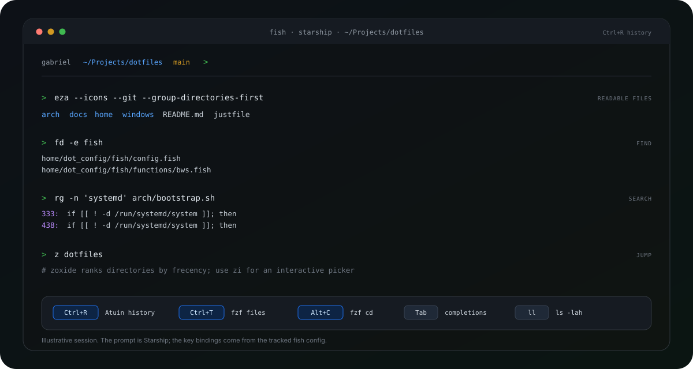
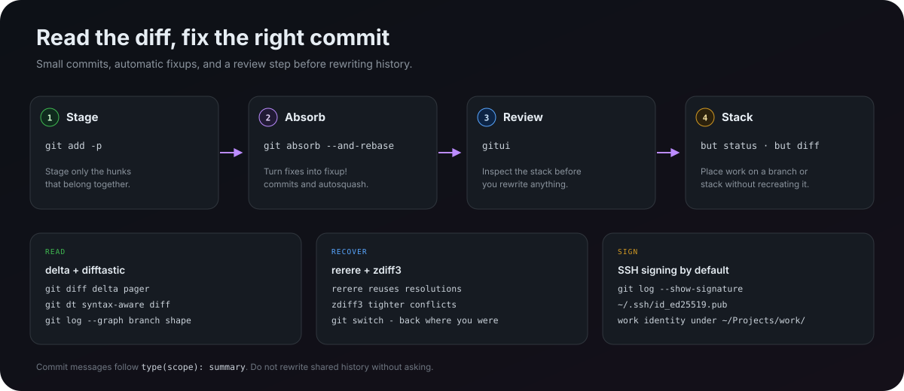
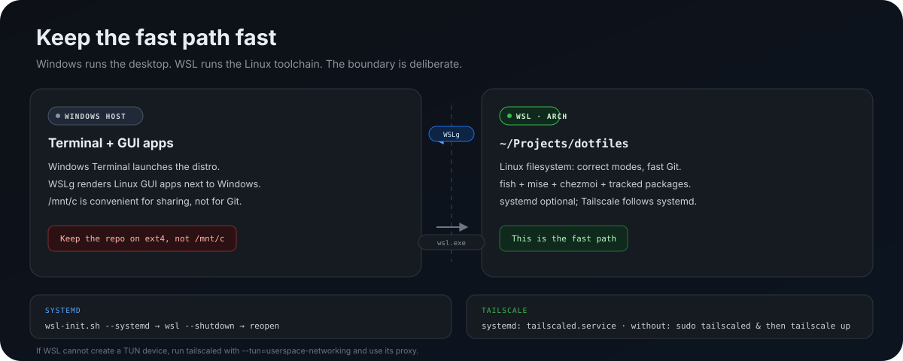

# Tips and tricks

Small habits that make this setup feel fast. Commands assume fish and the
repository at `~/Projects/dotfiles`.

The illustrations are local SVGs, so they render offline in GitHub, editors, and
terminal browsers. They are diagrams, not screenshots.



## Shell: fewer keystrokes

The tracked fish config adds five global abbreviations:

| Abbreviation | Expands to |
| --- | --- |
| `g` | `git` |
| `gs` | `git status --short --branch` |
| `gd` | `git diff` |
| `gl` | `git log --oneline --graph --decorate -20` |
| `ll` | `ls -lah` |

Abbreviations expand when you press space, so they stay visible before a command
runs. They are defined in `home/dot_config/fish/conf.d/40-abbr.fish`.

The interactive shell also receives:

- **Atuin** on `Ctrl+R` — searchable history, local-only
- **fzf** on `Ctrl+T` — pick a file, insert its path
- **fzf** on `Alt+C` — jump to a directory
- **zoxide** — `z <fragment>` jumps by frecency; `zi` opens a picker
- **Starship** — directory, Git branch, Node/Python versions, and command duration

Useful moves:

```bash
fd -e fish                         # find by extension, not by walking find(1)
rg -n 'tailscale' arch home        # search contents, respecting .gitignore
bat arch/bootstrap.sh              # read with syntax highlighting
eza --tree --level=2               # inspect a directory shape
dust -r                            # see what is using disk space
duf                                # see filesystems and free space
tldr pacman                        # examples before the full man page
```

`fd` and `rg` are usually better than `find` and `grep -R` in a repository this
size. They skip `.git`, respect ignore files, and return faster.

## Git: fix the commit, not the branch



The useful default is **small commits plus automatic fixups**. When a review
points out a problem in an earlier commit, stage only the fix and let
`git absorb` decide which commit owns it:

```bash
git add -p
git absorb --and-rebase
```

`git absorb -n` shows what it would do without changing history. If you prefer
the manual route, `git commit --fixup=<sha>` plus
`git rebase -i --autosquash <base>` produces the same shape.

Reading history is half the job:

```bash
git diff                  # delta pager, syntax highlighted
git dt                    # difftastic, syntax-aware structural diff
gl                        # graph log, last 20 commits
gitui                     # stage, inspect, and review in a TUI
```

Recovery and conflict habits:

- `rerere.enabled` and `rerere.autoupdate` reuse conflict resolutions
- `merge.conflictStyle = zdiff3` keeps the common ancestor in conflict markers
- `git switch -` returns to the previous branch
- `git restore -p` discards selected hunks instead of whole files
- `pull.rebase`, `rebase.autoStash`, and `push.autoSetupRemote` remove common
  setup steps

For stacked work this repository uses GitButler:

```bash
but status        # branch and commit placement
but diff          # inspect the selected change
but commit -b <branch> -m "type(scope): summary" <id> <id>
but move          # restack instead of recreating branches
```

Commit messages follow `type(scope): summary`. Do not rewrite pushed, reviewed,
or shared history without asking.

SSH signing is on by default. These checks should agree:

```bash
git config --show-origin --get gpg.format
git config --show-origin --get user.signingkey
git log --show-signature -1
```

Work projects under `~/Projects/work/` use the work email from
`~/.config/git/work.inc` and the same per-machine SSH key.

## chezmoi: preview everything

The source state is `home/`, not the repository root. `.chezmoiroot` makes that
work; the provisioning scripts stay one level up in `arch/`.

```bash
chezmoi diff                              # what would change
chezmoi apply --dry-run --verbose         # full preview
chezmoi apply                             # write the changes
chezmoi update                            # pull, then apply
```

Editing workflow:

```bash
chezmoi cd                                # opens the source state (home/)
chezmoi edit ~/.config/fish/config.fish   # edit the source, not the target
chezmoi re-add ~/.config/fish/config.fish # copy target changes back to source
chezmoi managed | rg fish                 # which targets are managed?
chezmoi doctor                            # diagnose source/config problems
```

If you edit a target file directly, run `chezmoi re-add` before the next apply.
Otherwise `chezmoi apply` will overwrite your change with the old source state.

`chezmoi apply` never installs packages or upgrades tools. Package upgrades stay
explicit: `sudo pacman -Syu` and `paru -Sua`.

## Packages: make drift deliberate

The bootstrap is a reconciler, not a package manager UI: it installs missing
packages and never removes anything.

```bash
just audit native
just audit-check native
./arch/audit.sh --profile native --json
```

Adding a package:

```bash
sudo pacman -S --needed <package>
paru -S --needed <aur-package>
$EDITOR arch/packages/base.txt        # or aur.txt / native.txt / wsl.txt
just audit native
```

Removing a package:

```bash
$EDITOR arch/packages/base.txt        # delete the line first
sudo pacman -Rns <package>            # then remove it deliberately
```

Useful checks:

```bash
pacman -Qqen | sort                   # explicit official packages
pacman -Qqem | sort                   # explicit AUR/foreign packages
pacman -Qo /usr/bin/bat               # which package owns this file
paccache -r                           # clear old package cache versions
arch-audit                            # known vulnerability report
```

Avoid `pacman -Sy` by itself. Update with `sudo pacman -Syu` so the package
database and installed packages never drift apart. Review AUR PKGBUILDs before
building, especially before `--yes`.

## mise: pin projects, not the world

The global config is for tools that should exist everywhere: Node, Bun, pnpm,
`ni`, and `git-flow`. Project versions belong in each project's `mise.toml`.

```bash
mise use node@22              # records node = "22" in the nearest project config
mise use --global node@22     # changes the global default
mise install                  # install everything in scope
mise ls                       # show resolved versions
mise outdated                 # compare configured and available versions
mise upgrade                  # upgrade within the configured ranges
```

For scripts and one-off commands, do not depend on interactive shell
activation. Be explicit:

```bash
mise x -- node --version
mise x -- pnpm install
mise run <task>
```

Fish activates mise only in interactive shells. That keeps shell startup quick
and makes the default environment predictable.

## WSL: keep the Linux side fast



Keep the repository inside the WSL filesystem:

```text
~/Projects/dotfiles        # ext4, correct file modes, fast Git
/mnt/c/Users/<you>/...     # convenient for sharing, slow for daily work
```

GUI notes:

- WSLg makes Linux GUI apps appear next to Windows. GitButler's GUI needs WSLg.
- Windows VS Code can connect to WSL through the Remote WSL extension.
- `wslview <url>` (from `wslu`) opens a URL in the Windows browser.

systemd is optional. To enable it, rerun the root init script from Windows or
inside WSL, then restart the distro:

```bash
sudo ./arch/wsl-init.sh --user <your-linux-user> --systemd
```

```powershell
wsl --shutdown
```

Reopen the distro. Bootstrap detects `/run/systemd/system` and manages
`tailscaled.service` and maintenance timers when systemd is available.

Without systemd, Tailscale needs a manual daemon:

```bash
sudo tailscaled >/tmp/tailscaled.log 2>&1 &
sudo tailscale up
```

If WSL cannot create a TUN device, use
`tailscaled --tun=userspace-networking` and its SOCKS/HTTP proxy for
applications that need tailnet access.

Keep `[interop] appendWindowsPath = true` if Windows GUI integration is useful.
If Windows `node.exe`, `git.exe`, or `python.exe` starts shadowing Linux tools,
check with `type -a node`, then set `appendWindowsPath = false` deliberately and
add explicit Windows helpers.

## Secrets: not plaintext at rest

The `bws` fish wrapper never exports the token globally. It loads the token only
for the `bws` process and its children. `./arch/auth.sh` offers to store the
token once, skips the prompt when an entry already exists, and accepts
`--skip-bws` to leave it manual. Because the wrapper is a fish function, bash
scripts and systemd units do not inherit the token; pass `BWS_ACCESS_TOKEN`
explicitly in those contexts.

**Native GNOME** 

```bash
secret-tool store --label='BWS access token' service bws account personal
secret-tool lookup service bws account personal
```

**WSL** 

```bash
gpg --full-generate-key
pass init <gpg-key-id>
pass insert bitwarden/bws-token
pass show bitwarden/bws-token
```

Use a read-only machine account token scoped to one project, and rotate it. For
application secrets, prefer `bws run -- <command>` over exporting a shell full
of environment variables.

Do not put private keys, tokens, or password-store data in the repository. SSH
keys stay per-machine; see the main README for the reasoning and the recovery
path.

## OpenCode and MCP

OpenCode comes from the official `extra` package. Do not use the self-updater
or put `~/.opencode/bin` ahead of `/usr/bin`; `just doctor` catches that.

The global OpenCode config tracks three MCP servers:

- `linear` — OAuth
- `jira` — OAuth
- `context7` — no authentication required

Check and repair authentication:

```bash
opencode mcp list
opencode mcp auth linear
opencode mcp auth jira
```

Inside a session, `/mcps` shows server status. `arch/auth.sh` connects the OAuth
servers and skips ones that are already connected; use `--skip-mcp`,
`--skip-linear`, or `--skip-jira` for intentional skips.

Context7 works without a key. Set `CONTEXT7_API_KEY` only if you want higher rate
limits, and add it as a header in `opencode.json` rather than committing a token.

## Recovery moves

When fish or a config breaks:

```bash
bash --noprofile          # a clean Bash shell
command fish              # bypass aliases/functions and try fish again
```

For dotfiles:

```bash
chezmoi doctor
chezmoi diff
chezmoi apply --dry-run --verbose
```

If `chezmoi` cannot find the source, check `sourceDir` in
`~/.config/chezmoi/chezmoi.toml`; bootstrap points it at this repository. Revert
bad dotfile changes with Git in the repo, then run `chezmoi apply`.

For package problems:

```bash
./arch/bootstrap.sh --profile native --dry-run
sudo pacman-key --refresh-keys
arch-audit
sudo systemctl list-timers --all
```

If pacman reports invalid signatures, refresh the keyring or re-populate the
Arch keyring. Do not leave the system in a `pacman -Sy`-only state. If a system
upgrade breaks boot, use a btrfs snapshot if available, or boot an Arch ISO and
chroot.

## A small maintenance rhythm

| When | Run |
| --- | --- |
| Start of a session | `gs`, `mise outdated` |
| After editing dotfiles | `chezmoi diff`, then `chezmoi apply` |
| Before committing | `just lint`, `just test` |
| After package changes | `just dry-run native`, `just audit-check native` |
| Weekly | `sudo pacman -Syu`, `paru -Sua`, `paccache -r`, `arch-audit` |
| After changing `wsl.conf` | `wsl --shutdown` |
| After upgrading tools | `./arch/completions.sh` |

## Next

- [Package catalog](packages.md) — every tracked package and its environment.
- [Back to the documentation index](README.md)
- [Back to the project README](../README.md)
